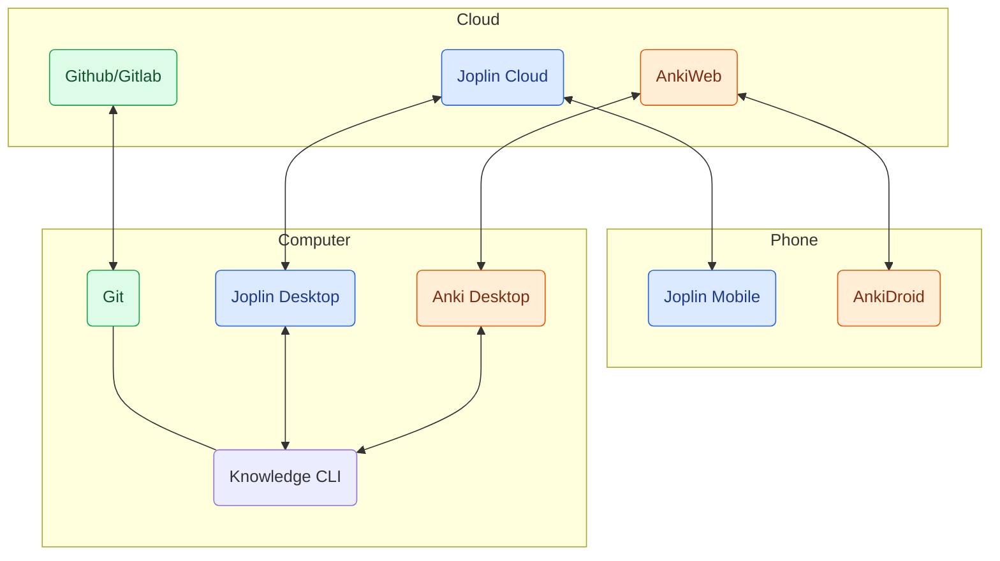

# System Architecture

Knowledge operates as a local-first system. The cloud integration is the "icing on the cake".

On your computer, it manages markdown notes in your filesystem (creation, research, deletion, etc.) and synchronizes them bidirectionally (import, export and merge) with two applications, each serving a different purpose:

- [Joplin](https://github.com/laurent22/joplin), to read and write the notes on every device
- [Anki](https://apps.ankiweb.net/), to learn selected notes through spaced repetition

Both work the same way: the local notes stay the reference, and edits made on the phone come back through the application's own sync and a merge on the computer.

